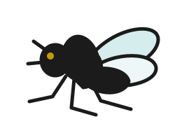
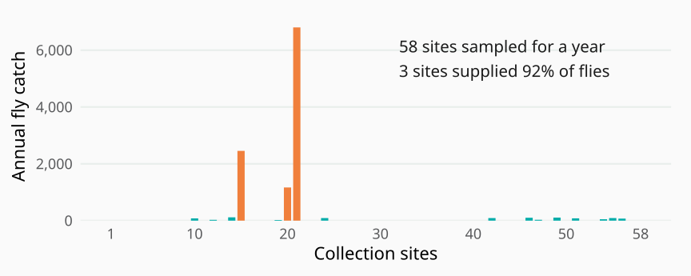
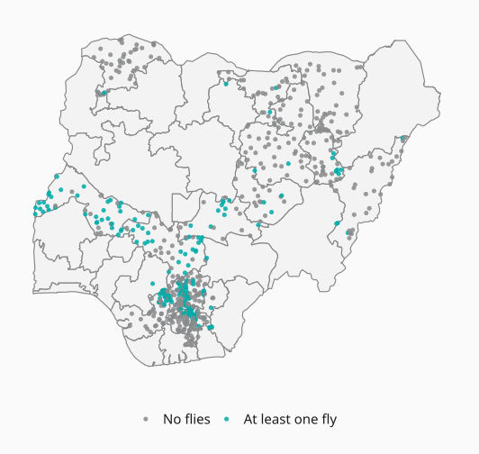
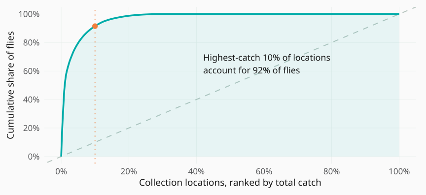
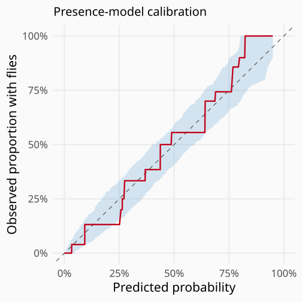
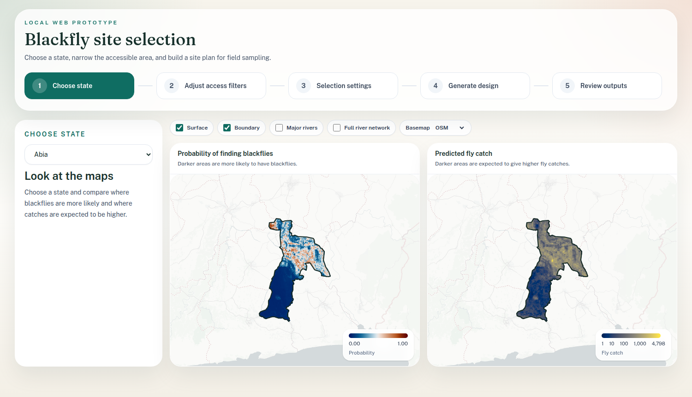
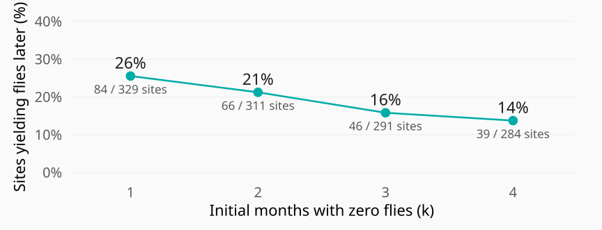
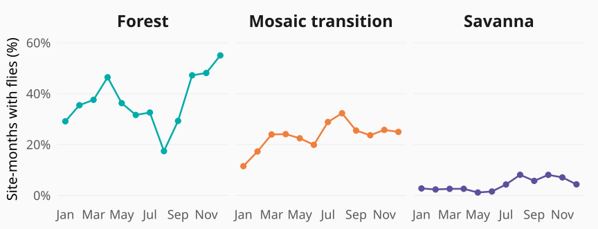
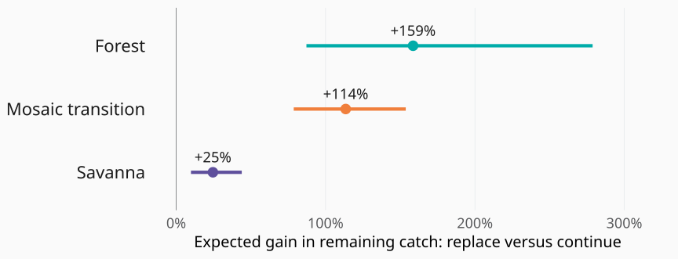
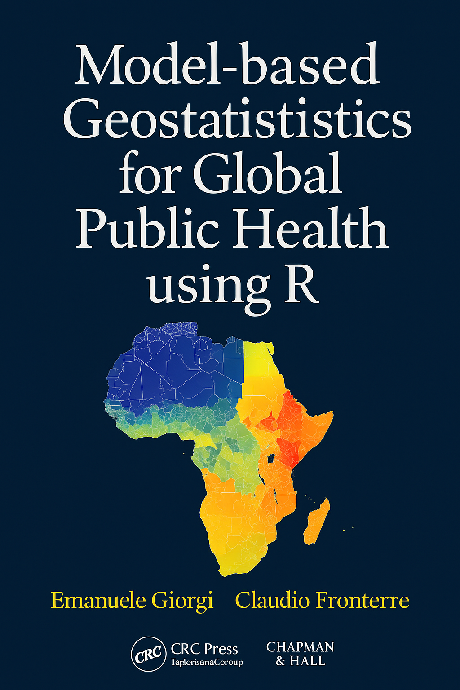

## Spatial Statistics for Decision-Making {.cover}

<h1>Spatial Statistics for Decision-Making</h1>
A Blackfly Tale

<strong>Dr. Claudio Fronterre</strong>
Senior Research Fellow in Statistical Science Department of Applied Health Sciences University of Birmingham, UK

<strong>The Future of Parasitology</strong>
12–13 October 2026

::: {.notes}
0:30. “The hardest question near elimination is not whether we have made progress. It is whether we have enough evidence to stop treatment. This is a story about one practical obstacle to obtaining that evidence: collecting the blackflies.”
:::

## Onchocerciasis

<em>Onchocerca volvulus</em> causes skin disease and eye damage, including blindness.

<h3>Blackflies <em>(Simulium)</em></h3>
Vectors breed in fast-flowing rivers

⇄
Transmission through blackfly bites

<h3>People</h3>
Infected people carry the parasite

Repeated ivermectin treatment aims to interrupt transmission.

::: {.notes}
1:00. Introduce the disease before asking the elimination question. Onchocerciasis is a neglected tropical disease targeted for elimination in WHO’s 2021–2030 NTD road map. Be precise: the 2030 target includes verified interruption of transmission in 12 countries, not global eradication by 2030. Source: https://www.who.int/publications/b/68270 “This is river blindness: a filarial parasite transmitted between people by biting blackflies. The disease affects skin and eyes. The flies breed in fast-flowing rivers, so geography matters from the start.” Icons are schematic, not anatomical identification guides; bidirectional arrow summarises the human–vector transmission cycle, not direct person-to-person transmission. Source: https://www.who.int/news-room/fact-sheets/detail/onchocerciasis
:::

## What evidence supports stopping treatment?

Evidence from people and vectors across the assessment area

<h3>Epidemiological assessment</h3>
Evidence of exposure to <em>O. volvulus</em> in children

Ov16 serology

<h3>Entomological assessment</h3>
Evidence of infective parasites in blackflies

O-150 PCR pool screening

Assess the evidence<b>→</b>Stop treatment when criteria are met<b>→</b>Post-treatment surveillance

::: {.notes}
1:00. “We need evidence from both sides of the transmission cycle: the population at risk and the vector. Human assessments use Ov16 serology, particularly in children; entomological assessments collect and test blackflies for infective parasites. These data inform stopping decisions, followed by post-treatment surveillance. National verification is a later decision.” Do not imply any single assay or fly target alone establishes elimination. Rare signals, survey design and geographic scope affect inference. WHO 2016 guidance: https://www.who.int/publications/i/item/9789241510011
:::

## Collecting enough blackflies for assessment {#first-we-need-to-collect-the-flies}

6,000

blackflies for entomological assessment across a transmission zone

<h3>Where should teams collect them?</h3>
Field time and resources are limited. Choosing where to allocate effort is crucial.

<strong>Entomological threshold: &lt;0.05% infective flies</strong>
Upper 95% confidence bound · fewer than 1 in 2,000 flies 6,000 tested with no infective larvae detected provides the required precision.

WHO (2016). <a href="https://www.who.int/publications/i/item/9789241510011"><em>Guidelines for stopping mass drug administration and verifying elimination of human onchocerciasis.</em></a>

::: {.notes}
1:15. “Before a laboratory can test the flies, someone has to catch them. Field time and resources are limited, so choosing where to allocate collection effort is crucial.” Transition: “This practical problem motivated our work with the Nigerian programme. Let me show you an example from Anambra.” WHO 2016: minimum 6,000 from a transmission zone tested and free of infective larvae supports an upper 95% bound below 0.05% among all flies. This is one component of assessment, not a stand-alone stopping rule. Source: https://iris.who.int/bitstream/handle/10665/204180/9789241510011_eng.pdf. Introduce Nigerian state operational units with the subsequent case study, not on this slide.
:::

## The problem that started this work

Anambra · 2021–2022 entomological assessment

FMoH / The Carter Center

::: {.notes}
1:30. “Teams visited 58 locations over a year. Three sites supplied 92% of the flies. The challenge was not just the total; it was field effort spread across many unproductive sites, and how well a small number of productive sites represented the assessment area.” This is the historical Anambra example, distinct from the 676-location model cohort. Rebuilt from cached annual catch values in docs/Recap _ Project Motivation.pptx, slide 2, chart1.xml. Preserve original site order; do not identify anonymised site indices with current model IDs. Original slide says 27% of selected sites caught flies; cached chart has 16/58=27.6%, so say “most sites yielded none” instead of repeating rounded discrepancy. Geographic concentration alone does not quantify transmission bias.
:::

## The Nigerian data behind Blackfly Finder

<strong>676</strong>trap locations

<strong>7,617</strong>observed site-months

<strong>2020–2025</strong>monthly collection records

Human landing collections

FMoH / TCC and SORT records

::: {.notes}
1:00. Introduce scope before analysing the data. Source files Nigeria_ento_TCCstates_17mar23_monthly.csv and sort_clean_2026.csv. Audited full cohort: 676 locations, 7,617 nonmissing observed site-month records, 91,290 flies. Missing catch entries were not treated as zero. Different observation durations mean map positivity describes any observed catch, not directly comparable annual abundance. The corrected seasonal subset later is 664 sites / 7,513 records, excluding 12 all-zero Wetland sites as specified. Boundaries from saved national model object.
:::

## Catch is concentrated in a few sites

::: {.notes}
1:15. Rebuilt from the audited full 676-location cohort (7,617 site-months); monthly totals match the saved national model exactly. The highest-catch 10% supply approximately 92% of flies. Concentration does not establish geographic transmission patterns.
:::

## Blackfly Finder: a two-part hurdle model {#the-collection-model-has-two-parts}

0/+
<h3>Will we find flies?</h3>
Probability of a positive catch

Ensemble of presence models

<i></i><i></i><i></i><i></i><i></i>
<h3>How many might we collect?</h3>
Expected catch when flies are found

Negative-binomial count model

<strong>Expected catch</strong>=Probability of finding flies×Expected positive catch

Allows for differences in observation duration.

::: {.notes}
0:55. This is a hurdle model. The binary part separates zero and positive catches; the positive-count part uses a zero-truncated negative-binomial distribution to accommodate very variable positive catches. A log(n_months) offset in the count component accounts for differing observation durations. Presence refers to finding flies over the observed collection regime, not true vector absence or a standardised one-day probability. The selected presence component uses stacked predictions from penalised logistic regression, random forest and XGBoost; this is an ensemble of collection predictions, not a Bayesian model. The product is the expected total catch at the specified observation duration. Neither component estimates infectivity or transmission risk.
:::

## What informs Blackfly Finder?

≈<h3>Rivers and terrain</h3>
Hydrology and landscape shape

☀<h3>Climate</h3>
Temperature and rainfall

≋<h3>Soils</h3>
Soil properties and temperature

⌁<h3>Land and vegetation</h3>
Land cover, population and livestock

<h3>Presence / absence</h3>
Environmental inputs combined in an ensemble of presence models

<h3>Positive-catch intensity</h3>
Air temperature range · soil clay content Soil temperature seasonality · terrain variation

Different predictors can explain where flies are found and how many are caught.

::: {.notes}
1:50. “We used ecological knowledge and predictive performance to select variables separately for the two parts.” Introduce candidate environmental layers, then explain separate predictor selection for the two hurdle components. Candidate domains: hydrology, geomorphometry, climate, soil features, vegetation, land cover, population and livestock. Candidate inputs are not all retained in the final model. Science-informed grouping/PCA and algorithm-informed raw-variable selection were compared in the original Story deck. Presence combines penalised logistic regression, random forest and XGBoost; positive counts use the four retained variables shown. Predictor sets need not be disjoint; associations are predictive rather than causal. Static environmental layers support geographic prediction, while seasonal modelling is introduced later. Intensity here means positive catch, not transmission intensity.
Predictor selection is conducted separately for presence and positive counts: different sets and functions can be retained; this does not imply the sets are disjoint. In this slide intensity means positive-catch abundance, not transmission intensity. The original Story deck compares science-informed domain grouping/PCA with algorithm-informed raw-variable selection, ensembles and separate binary/count evaluation. The saved mapped model is H_raw_raw / negbin: presence is bin__pred_stack; count includes CHELSA_bio2_r (mean diurnal air-temperature range), CLYPPT_WeigAver_r (soil clay), SBIO4_Temperature_Seasonality_5_15cm_r (soil temperature seasonality) and dev_scale (terrain deviation scale). These predictors are associations, not causal effects or variable-importance rankings. Confirm names against the fitted formula in outputs/models/nonspatial_hurdle/hurdle__H_raw_raw__negbin.rds. Model comparison uses 10-fold location-level CV and ranks hurdle candidates by RMSE, then MAE and deviance in 16_prediction_and_mapping.R. Random folds do not establish transfer to a new state; separate geographic validation is necessary. Handoff reports limited leave-one-state-out checks and difficulty with exceptional catches. Do not overstate validation or field gains. Combined-model CV may condition on upstream selected/stacked features, so avoid presenting an unbiased performance claim without nested validation. This slide incorporates the former standalone validation slide.
:::

## Where should teams look for blackflies? {#where-are-collections-more-likely-to-be-positive}

Cross-validated base predictions Shaded 90% consistency band

::: {.notes}
1:30. Left is the saved H_raw_raw negative-binomial hurdle map of collection positivity, with a sequential pale-to-deep-blue probability scale. Right is an isotonic reliability diagram computed from the saved presence ensemble's out-of-fold base predictions, using reliabilitydiag with a 90% pointwise consistency region around the diagonal (1,000 resamples; seed 20261011). This restores the method/style visible on Story deck slides 12–13, but the original v1/v2 data source has not been identified and this is not a reproduction of their curves. The band describes expected calibration variation under the package's calibrated independent-observation assumptions, not spatial transfer uncertainty or a confidence band around the red curve. Ensemble weights and upstream selection use the same data: not a fully independent hold-out test of the final mapped hurdle model. These predict collection positivity, not infectivity. Do not imply independent validation or causal effects.
:::

## Where can teams collect? {#field-access-shapes-the-sampling-region}

Define a feasible sampling region.

<strong>5 km</strong>from rivers

<strong>2 km</strong>from roads

<strong>5 km</strong>from populated areas

A location must satisfy all three access limits.

Abia · blue cells satisfy all three limits

Illustrative settings · teams can adjust the limits to local field conditions.

::: {.notes}
1:30. “We now have spatial predictions, but a high predicted catch is useful only if the team can collect there. First we define the feasible sampling region: close enough to rivers, roads and populated areas. A candidate location must satisfy all three filters.” For this saved Abia example: distance to HydroRIVERS ≤5 km, roads ≤2 km and populated areas ≤5 km. The population layer supplies a distance proxy, not confirmation of permission or field access. These settings are adjustable; actual access, safety and suitable collection positions require local review. The February Story deck used earlier settings (including 5 km from roads and 10 km spacing); this slide deliberately uses the current saved Abia protocol settings. Source: outputs/sampling_app_cache/Abia.rds, grid distance fields; 18_sampling-protocol.R access masks. Figure: assets/operational-access.svg, generated by rebuild_operational_maps.R. Transition: “Within that feasible region, which sites should we choose?”
:::

## Choosing sites within the feasible region {#a-sampling-plan-for-abia}

Abia example · 30 proposed sites

<h3>Prioritise finding flies</h3>
Rank feasible locations by their predicted probability.

<h3>Keep sites apart</h3>
At least 5 km between selected sites.

<h3>Check major-river coverage</h3>
A selected site within 30 km of each sampled river point.

Orange: proposed sites · grey: major rivers

Proposed design for review · access, spacing and river coverage are checked together.

::: {.notes}
1:45. “We rank accessible locations by the probability of finding flies, then balance that priority with geographic spread. Here we choose 30 sites, keep them at least five kilometres apart, and check coverage of the major river network. That can require choosing a less productive location to cover an otherwise missed area.” This is the saved probability_first/K30 proposed design, not the separate approved Abia primary-site list. Sources: outputs/sampling_protocol/probability_first/Abia/K30/selected_sites.csv and river_coverage_summary.csv; selection strategy and coverage repair in 18_sampling-protocol.R. All 30 sites satisfy the three access masks; the map rebuild checked minimum pairwise separation ≥5 km. Coverage was checked at 232 sampled points along 447.4 km of the supplied major-river network; saved maximum distance to a selected site is 29.99 km, with zero uncovered length in the sampled-point approximation. The 30 km rule is a geographic design setting, not a biological dispersal assumption or proof of transmission representativeness. Access filtering uses HydroRIVERS, while coverage uses the supplied major-river layer; river-layer choice matters. Probability is collection positivity, not parasite infectivity; this strategy prioritises finding flies rather than maximising predicted total catch. Field teams still review locations and the geographic scope before implementation. Figure: assets/operational-plan.svg, generated by rebuild_operational_maps.R. Transition: “Blackfly Finder makes these choices available to the programme team.”
:::

## A sampling web-tool teams can use {#blackfly-finder-a-plan-teams-can-use}

::::: {.finder-screen-layout}

:::: {.finder-screen}

{alt="Blackfly Finder Choose state screen, showing Abia collection probability and predicted catch"}

::::

:::: {.finder-screen-steps}

::: {.workflow-step}
**1. Set constraints**

Choose the state, access limits and site spacing.
:::

::: {.workflow-step}
**2. Generate and review**

Inspect the proposed sites and coverage.
:::

::: {.workflow-step}
**3. Download the plan**

Export coordinates and the design summary.
:::

::::

:::::

::: {.notes}
1:30. “These choices are available in Blackfly Finder. The team sets the field constraints, generates and reviews a proposed design, then downloads site coordinates and the design summary. Local knowledge remains essential when reviewing the plan.” Screenshot supplied by Claudio from docs/user-guide/assets/01-choose-state.png: Choose state screen, Abia, showing collection probability and predicted catch. The local prototype is titled “Blackfly site selection” in the interface. Its five interface stages are summarised here as three actions. Source: webapp/src/App.jsx and api/run_api.R. A generated design and the selected-sites/summary download controls were inspected in the Review outputs screen; screenshot displays the state-selection interface and prediction maps. Predicted yield is not observed field performance. Distinguish implemented functionality from demonstrated deployment or realised collection gains. Transition: “And what happens when the team follows the plan, but a site keeps producing no flies?”
:::

## Could an adaptive strategy improve sampling? {#three-months-with-no-flies}

Three monthly visits to the same site. No flies caught.

Month 1<strong>0</strong><small>flies</small>

Month 2<strong>0</strong><small>flies</small>

Month 3<strong>0</strong><small>flies</small>

Would you stay at this site, or move?

:::: {.closing-options .zero-options}
::: {.closing-option}
**Stay at the site**

A more productive season may be ahead.
:::
::: {.closing-option}
**Move to a reserve site**

Another site may offer a better yield.
:::
::::

::: {.notes}
1:15. “The map gives us an initial plan. But what should we do when collections start coming back? Suppose this site yields no flies in three successive monthly visits. Would you stay, or move?” Pause for the audience. This is an illustrative scenario, not an observed named site or a universal three-month replacement rule. We compare expected future catch after repeated zeros, while retaining operational and geographic constraints. A zero catch is information about collection productivity; it is not evidence that transmission has been interrupted. Transition: “The calendar matters when we interpret those zeros.”
:::

## What do repeated zeros imply? {#conditional-outlook}

:::: {.closing-chart}
{alt="Observed later-positive proportions after initial zero catches, pooling ecological zones: after one zero month 84 of 329 sites, after two 66 of 311, after three 46 of 291, after four 39 of 284"}
::::

After three zero months, 16% of sites yielded flies in months 4–12.

::: {.notes}
1:00. Empirical descriptive analysis, pooling the ecological zones represented in the corrected664-site seasonal cohort. Use each site's earliest complete consecutive12-calendar-month sequence. Require an observed record in every month, so missing records never count as zeros. Exactly374sites meet this requirement, with4488site-months in selected windows; the full observed-seasonality slide retains its664sites and7513site-months. No ecological stratification, model assumptions or modelled predictions in this figure. For k=1,2,3,4, select sites with zero catches in every one of their first k months and calculate the proportion with at least one positive catch in months k+1 through12. Results:84/329=25.5%,66/311=21.2%,46/291=15.8%,39/284=13.7%. Denominators differ because eligibility conditions become stricter. Remaining follow-up also shortens as k grows. This is an observed conditional proportion in selected complete follow-up windows, not independent validation, a causal effect, or a universal forecast for a new site. Lines connect the four summaries. Start months and zones vary between sites; interpret the subsequent seasonal slide as context for that pooled pattern. Same corrected664-site source as the seasonal chart, retaining its exclusion of12all-zeroWetland sites. Reproducible source: rebuild_empirical_outlook.R. Audit and site-level windows: data/empirical-outlook-audit.txt, data/empirical-outlook-site-windows.csv; counts: data/empirical-outlook-summary.csv. The replacement-gain figure later remains explicitly modelled.
:::

## Season changes the chance of finding flies {#collection-success-varies-by-season-and-ecological-setting}

:::: {.closing-chart}
{alt="Observed proportions of monthly collections yielding flies in Forest, Mosaic transition and Savanna, on a common zero-to-sixty-percent scale"}
::::

:::: {.closing-message}
Repeated zeros need to be interpreted in their seasonal context.
::::

::: {.notes}
1:45. “Monthly collection success varies through the year, and the observed patterns differ across these ecological settings. The same three zero catches can therefore occur under very different expectations. We need to ask what those observations imply for the months still ahead.” Points show observed positive site-month proportions within eco-zone and calendar month, not fitted seasonal curves. Common 0–60% vertical scale; lines connect monthly summaries. Source: seasonality_adapative_sampling/cohort_audit/seasonal_cohort_664.csv; summary in presentation/seasonality-values.csv. Corrected cohort: 664 sites, 7,513 site-months. Twelve all-zero Wetland sites are outside the three-zone seasonal analysis. Original 660-site input is preserved. Unequal sampling composition, repeated visits and calendar-month/state confounding prevent causal interpretation of these ecological contrasts. No independent-binomial uncertainty bands are asserted. Transition: “We use that seasonal context to compare staying with replacing.”
:::

## When could replacing a site improve catches?

After three zero months: compare the expected catch over the remaining nine months.

:::: {.closing-chart .gain-chart}
{alt="Modelled replacement gains after three zero months: Forest mean 159 percent, Mosaic transition 114 percent, Savanna 25 percent; lines show ranges across calendar start months"}
::::

The potential gain depends on ecological setting and when sampling starts.

Modelled scenario. Dots show the mean gain across start months. Lines show the lowest and highest gains across start months.

::: {.notes}
1:45. “For a twelve-month collection programme, suppose the first three monthly collections yield zero flies. We compare the expected remaining catch at that site with the catch from a fresh replacement site in the same ecological setting and the same remaining calendar months. In these scenarios replacement offers the largest relative gain in Forest, followed by Mosaic transition, and a smaller gain in Savanna.” Means rounded on the figure: Forest 158.6%, Mosaic 113.5%, Savanna 24.6%; ranges 87.2–278.8%, 78.7–153.7%, 9.9–43.9%. Source: cohort_audit/corrected664/appendixV2_seasonal_summary_table.csv, k=3; calculation in src/05_appendix_closed_form.py, seasonal_gain, N_MONTHS=12. Mean and min/max span the twelve calendar start months. These are relative modelled gains in remaining catch, not percentage-point improvements in detection or realised field performance. The replacement starts fresh under the model; no transfer costs or geographic coverage constraints enter this gain calculation. Seasonal scenario uses the pooled zero-propensity distribution with zone-specific monthly exponents. Model assumptions and month/state confounding remain. This does not establish an optimal three-month stopping rule. Transition: “A promising expected gain is a reason to test the strategy in the field.”
:::

## An adaptive strategy to test {#an-adaptive-plan-needs-a-field-test}

:::: {.strategy-rows}
::: {.strategy-row}

1

::: {.strategy-text}
**Prepare original and reserve sites**

Use the same selection process for both.
:::
:::
::: {.strategy-row}

2

::: {.strategy-text}
**Choose when to replace a site**

Compare **1–4 initial zero months**, accounting for season and start month.
:::
:::
::: {.strategy-row}

3

::: {.strategy-text}
**Validate with parallel field sampling**

Follow original sites for **12 months** and sample reserves alongside them. Compare fly yields over the same calendar months.
:::
:::
::::

::: {.notes}
1:45. Source: docs/adaptive_design_phase2.tex and docs/adaptive_ento_sampling (2).pdf, sections 5–7. Candidate designs compare replacement after k=1,2,3,4 initial zero months, retaining the replacement or applying the rule again. Evaluate by eco-zone and calendar start month; the draft suggests k=3 or4 and starts near the zone's productive season as candidates, not a validated universal rule. Original and replacement sites should use the same selection process. For prospective validation the draft proposes augmenting the Abia, Anambra and Delta study with replacements sampled in months4–12 while continuing all original sites throughout12months, enabling k3/k4 comparisons. Other prospective studies could sample a pool of potential replacements for all12months, supporting k1–4 comparisons. These are proposals with resource implications, not confirmed field implementation. Compare total fly yield with matched calendar months and consistent measurement protocols. Current slide16 displays the earlier saved pooled seasonal scenario, not all model versions in the revised draft. Its numerical gains remain illustrative; do not imply that they select the final rule.
:::

## From blackfly sampling to elimination assessment {#adding-evidence-about-transmission}

Next research steps

:::: {.transmission-next}
::: {.transmission-next-item}
{alt="Laboratory tubes representing testing of blackfly samples"}

**Test the collected flies**

Use infectivity tests to investigate where infective flies occur.
:::
::: {.transmission-next-item}
{alt="Blood sample representing human epidemiological evidence"}

**Combine human and vector evidence**

Develop joint models of epidemiological and entomological observations.
:::
::::

Better sampling strengthens the evidence for elimination assessment. Fly yield alone does not establish interrupted transmission.

::: {.notes}
1:30. “Our current work helps decide where to collect and when to reconsider an unproductive site. It supports obtaining the evidence needed for elimination assessment. The next step is to incorporate infectivity testing and bring human and vector observations together, moving from predictions of catch to evidence about transmission.” Planned directions supplied by Claudio, not completed joint models. Collection productivity and parasite infectivity are different outcomes. Assays, field design and the geographic scope affect later inference; none of the collection maps or adaptive gains alone establishes interruption or authorises stopping treatment. This is the final main-talk slide following removal of the former summary slide. Acknowledge Nigerian collaborators, field teams and Peter Diggle verbally; complete collaborator names should be confirmed for the final conference version. Invite questions on the link between field design and the evidence needed to make elimination decisions.
:::

## Conclusions {.conclusions-clean #take-home-message}

::: {.conclusion-bullets}
- **Spatial predictions** help target sampling within accessible areas.
- **Seasonal evidence** helps teams interpret repeated zero catches.
- **Accessible web tools** put sampling plans in the hands of field teams.
:::

::: {.conclusion-next-label}
Next research steps
:::

:::: {.conclusion-next-grid}
::: {.conclusion-next-item}
**Field validation**

Test the adaptive strategy through prospective comparisons of fly yield.
:::
::: {.conclusion-next-item}
**A joint epi–ento model**

Combine epidemiological and entomological evidence to assess transmission.
:::
::::

::: {.notes}
0:45. Close the scientific story. Models support field decisions about where to sample and whether to replace an unproductive site. The current work predicts fly presence and yield, not parasite transmission. Next steps are prospective validation before recommending a replacement rule and development of a joint epidemiological–entomological model. Acknowledge Nigerian collaborators and field teams, and Peter Diggle.
:::

## Coming soon: a new book {#new-book}

:::: {.book-layout}
::: {.book-cover}
{alt="Book cover: Model-based Geostatistics for Global Public Health using R, by Emanuele Giorgi and Claudio Fronterre"}
:::
::: {.book-copy}
**Model-based Geostatistics for Global Public Health using R**

Emanuele Giorgi and Claudio Fronterre

A hands-on introduction to disease mapping with the **RiskMap** package and real-world case studies.

Read online at [**mbgr.org**](https://mbgr.org).
:::
::::

::: {.notes}
0:20. Book cover and promotional text taken from Claudio's Stat_Seminar_Birmingham_06102026/slides.Rmd and figs/book.png. Preserve the reference's “Coming soon” status without inventing a publication date. This slide follows the scientific conclusion.
:::

## Grazie! {.thanks-slide #grazie}

Grazie!

Claudio Fronterre

<a href="mailto:c.fronterre@bham.ac.uk">c.fronterre@bham.ac.uk</a>

::: {.notes}
Email verified against Claudio's supplied Birmingham seminar deck. Invite questions.
:::
