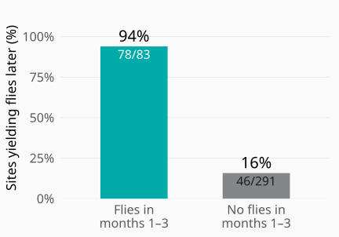
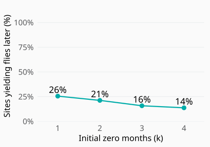

## Spatial Statistics for Decision-Making {.cover}

<h1>Spatial Statistics for Decision-Making</h1>
A Blackfly Tale

<strong>Dr. Claudio Fronterre</strong>
Senior Research Fellow in Statistical Science Department of Applied Health Sciences University of Birmingham, UK

<strong>The Future of Parasitology</strong>
12–13 October 2026

## Onchocerciasis

<em>Onchocerca volvulus</em> causes skin disease and eye damage, including blindness.

<h3>Blackflies <em>(Simulium)</em></h3>
Vectors breed in fast-flowing rivers

⇄
Transmission through blackfly bites

<h3>People</h3>
Infected people carry the parasite

Repeated ivermectin treatment aims to interrupt transmission.

## What evidence supports stopping treatment?

Evidence from people and vectors across the assessment area

<h3>Epidemiological assessment</h3>
Evidence of exposure to <em>O. volvulus</em> in children

Ov16 serology

<h3>Entomological assessment</h3>
Evidence of infective parasites in blackflies

O-150 PCR pool screening

Assess the evidence<b>→</b>Stop treatment when criteria are met<b>→</b>Post-treatment surveillance

## Collecting enough blackflies for assessment {#first-we-need-to-collect-the-flies}

6,000

blackflies for entomological assessment across a transmission zone

<h3>Where should teams collect them?</h3>
Field time and resources are limited. Choosing where to allocate effort is crucial.

<strong>Entomological threshold: &lt;0.05% infective flies</strong>
Upper 95% confidence bound · fewer than 1 in 2,000 flies 6,000 tested with no infective larvae detected provides the required precision.

WHO (2016). <a href="https://www.who.int/publications/i/item/9789241510011"><em>Guidelines for stopping mass drug administration and verifying elimination of human onchocerciasis.</em></a>

## The problem that started this work

Anambra · 2021–2022 entomological assessment

FMoH / The Carter Center

## The Nigerian data behind Blackfly Finder

<strong>676</strong>trap locations

<strong>7,617</strong>observed site-months

<strong>2020–2025</strong>monthly collection records

Human landing collections

FMoH / TCC and SORT records

## Catch is concentrated in a few sites

## Blackfly Finder: a two-part hurdle model {#the-collection-model-has-two-parts}

0/+
<h3>Will we find flies?</h3>
Probability of a positive catch

Ensemble of presence models

<i></i><i></i><i></i><i></i><i></i>
<h3>How many might we collect?</h3>
Expected catch when flies are found

Negative-binomial count model

<strong>Expected catch</strong>=Probability of finding flies×Expected positive catch

Allows for differences in observation duration.

## What informs Blackfly Finder?

≈<h3>Rivers and terrain</h3>
Hydrology and landscape shape

☀<h3>Climate</h3>
Temperature and rainfall

≋<h3>Soils</h3>
Soil properties and temperature

⌁<h3>Land and vegetation</h3>
Land cover, population and livestock

<h3>Presence / absence</h3>
Environmental inputs combined in an ensemble of presence models

<h3>Positive-catch intensity</h3>
Air temperature range · soil clay content Soil temperature seasonality · terrain variation

Different predictors can explain where flies are found and how many are caught.

## Where should teams look for blackflies? {#where-are-collections-more-likely-to-be-positive}

Cross-validated base predictions Shaded 90% consistency band

## Where can teams collect? {#field-access-shapes-the-sampling-region}

Define a feasible sampling region.

<strong>5 km</strong>from rivers

<strong>2 km</strong>from roads

<strong>5 km</strong>from populated areas

A location must satisfy all three access limits.

Abia · blue cells satisfy all three limits

Illustrative settings · teams can adjust the limits to local field conditions.

## Choosing sites within the feasible region {#a-sampling-plan-for-abia}

Abia example · 30 proposed sites

<h3>Prioritise finding flies</h3>
Rank feasible locations by their predicted probability.

<h3>Keep sites apart</h3>
At least 5 km between selected sites.

<h3>Check major-river coverage</h3>
A selected site within 30 km of each sampled river point.

Orange: proposed sites · grey: major rivers

Proposed design for review · access, spacing and river coverage are checked together.

## A sampling web-tool teams can use {#blackfly-finder-a-plan-teams-can-use}

::::: {.finder-screen-layout}

:::: {.finder-screen}

{alt="Blackfly Finder Choose state screen, showing Abia collection probability and predicted catch"}

::::

:::: {.finder-screen-steps}

::: {.workflow-step}
**1. Set constraints**

Choose the state, access limits and site spacing.
:::

::: {.workflow-step}
**2. Generate and review**

Inspect the proposed sites and coverage.
:::

::: {.workflow-step}
**3. Download the plan**

Export coordinates and the design summary.
:::

::::

:::::

## Could an adaptive strategy improve sampling? {#three-months-with-no-flies}

Three monthly visits to the same site. No flies caught.

Month 1<strong>0</strong><small>flies</small>

Month 2<strong>0</strong><small>flies</small>

Month 3<strong>0</strong><small>flies</small>

Would you stay at this site, or move?

:::: {.closing-options .zero-options}
::: {.closing-option}
**Stay at the site**

A more productive season may be ahead.
:::
::: {.closing-option}
**Move to a reserve site**

Another site may offer a better yield.
:::
::::

## What do repeated zeros imply? {#conditional-outlook}

:::: {.empirical-pair}
::: {.empirical-panel}
**Early catches distinguish later success**

Months 4–12

{alt="Among our374sites, later positive catches occurred at78of83initially productive sites,94percent, versus46of291initially zero sites,16percent"}
:::
::: {.empirical-panel}
**What follows a run of zeros?**

Remaining 12 − k months

{alt="Observed later-positive proportions after1through4initial zero months:26,21,16and14percent, with12minuskmonths remaining"}
:::
::::

Early catches help identify sites more likely to yield flies later.

## Season changes the chance of finding flies {#collection-success-varies-by-season-and-ecological-setting}

:::: {.closing-chart}
{alt="Observed proportions of monthly collections yielding flies in Forest, Mosaic transition and Savanna, on a common zero-to-sixty-percent scale"}
::::

:::: {.closing-message}
Repeated zeros need to be interpreted in their seasonal context.
::::

## When could replacing a site improve catches?

After three zero months: compare the expected catch over the remaining nine months.

:::: {.closing-chart .gain-chart}
{alt="Modelled replacement gains after three zero months: Forest mean 159 percent, Mosaic transition 114 percent, Savanna 25 percent; lines show ranges across calendar start months"}
::::

The potential gain depends on ecological setting and when sampling starts.

Modelled scenario. Dots show the mean gain across start months. Lines show the lowest and highest gains across start months.

## An adaptive strategy to test {#an-adaptive-plan-needs-a-field-test}

:::: {.strategy-rows}
::: {.strategy-row}

1

::: {.strategy-text}
**Prepare original and reserve sites**

Use the same selection process for both.
:::
:::
::: {.strategy-row}

2

::: {.strategy-text}
**Choose when to replace a site**

Compare **1–4 initial zero months**, accounting for season and start month.
:::
:::
::: {.strategy-row}

3

::: {.strategy-text}
**Validate with parallel field sampling**

Follow original sites for **12 months** and sample reserves alongside them. Compare fly yields over the same calendar months.
:::
:::
::::

## From blackfly sampling to elimination assessment {#adding-evidence-about-transmission}

Next research steps

:::: {.transmission-next}
::: {.transmission-next-item}
{alt="Laboratory tubes representing testing of blackfly samples"}

**Test the collected flies**

Use infectivity tests to investigate where infective flies occur.
:::
::: {.transmission-next-item}
{alt="Blood sample representing human epidemiological evidence"}

**Combine human and vector evidence**

Develop joint models of epidemiological and entomological observations.
:::
::::

Better sampling strengthens the evidence for elimination assessment. Fly yield alone does not establish interrupted transmission.

## Conclusions {.conclusions-clean #take-home-message}

::: {.conclusion-bullets}
- **Spatial predictions** help target sampling within accessible areas.
- **Seasonal evidence** helps teams interpret repeated zero catches.
- **Accessible web tools** put sampling plans in the hands of field teams.
:::

::: {.conclusion-next-label}
Next research steps
:::

:::: {.conclusion-next-grid}
::: {.conclusion-next-item}
**Field validation**

Test the adaptive strategy through prospective comparisons of fly yield.
:::
::: {.conclusion-next-item}
**A joint epi–ento model**

Combine epidemiological and entomological evidence to assess transmission.
:::
::::

## Coming soon: a new book {#new-book}

:::: {.book-layout}
::: {.book-cover}
{alt="Book cover: Model-based Geostatistics for Global Public Health using R, by Emanuele Giorgi and Claudio Fronterre"}
:::
::: {.book-copy}
**Model-based Geostatistics for Global Public Health using R**

Emanuele Giorgi and Claudio Fronterre

A hands-on introduction to disease mapping with the **RiskMap** package and real-world case studies.

Read online at [**mbgr.org**](https://mbgr.org).
:::
::::

## Acknowledgments {#acknowledgments}

::: {.ack-funder}
**Funding support**

Gates Foundation
:::

:::: {.ack-grid}
::: {.ack-group}
**Nigerian programme and partners**

Federal Ministry of Health and NOEC The Carter Center Sightsavers and CBM
:::
::: {.ack-group}
**Research and field teams**

Peter Diggle and our collaborators Entomologists and fly collectors Communities supporting field sampling
:::
::::

## Grazie! {.thanks-slide #grazie}

Grazie!

Claudio Fronterre

<a href="mailto:c.fronterre@bham.ac.uk">c.fronterre@bham.ac.uk</a>

## Backup: models and analysis datasets {.technical-backup}

| Analysis | Dataset and purpose |
|---|---|
| Blackfly Finder | 676 locations; total catch and observed duration |
| Observed seasonality | 664 sites; 7,513 site-months |
| Early versus later catches | 374 sites; first complete 12-month window |
| Adaptive scenarios | Latent zero propensity and monthly seasonal exponents |

The mapped model, descriptive analyses and adaptive scenarios answer different questions.

## Backup: the mapped hurdle distribution {.technical-backup}

Let Y be total fly catch at a site and p = P(Y > 0).

P(Y = 0) = 1 − p

P(Y = y) = p · fNB(y; μ, θ) / [1 − fNB(0; μ, θ)], &nbsp; y ≥ 1

E(Y) = p · μ / [1 − (θ / (θ + μ))θ]

The positive-count distribution is zero-truncated. μ is the underlying negative-binomial mean, not the truncated mean.

## Backup: presence score and calibration {.technical-backup}

Candidate learners: elastic-net logistic regression, XGBoost and random forest.

q(x) = Σj wj qj(x)

Saved weights: elastic net **0**, XGBoost **0**, random forest **1**.

logit p(x) = −3.033 + 6.016 q(x)

The mapped hurdle model applies this logistic regression to the saved prediction score.

## Backup: fitted random-forest presence score {.technical-backup}

**500 trees**, mtry = **4**, minimum node size = **10**, Gini splitting.

<pre>soilT_1_0_5cm_r
ndti
CRFVOL_WeigAver_r
slope_grad_dw_cel
soilT_2_0_5cm_r
rough_scale
soilT_9_0_5cm_r
AWCtS_WeigAver_r
occurence_proximity
rough_magnitude
LC2021</pre><pre>SBIO4_Temperature_Seasonality_5_15cm_r
CLYPPT_WeigAver_r
SLTPPT_WeigAver_r
CHELSA_bio14_r
sti
CHELSA_bio11_r
SNDPPT_WeigAver_acc
stream_dist_dw_near
convergence
LS_Ct
ndwi</pre>

The saved prediction bundle retains these 22 environmental inputs and training medians for imputation.

## Backup: positive-catch model {.technical-backup}

log μ = log T + 2.173 − 0.581 x1 + 1.029 x2 − 0.273 x3 − 0.281 x4

| Predictor | Retained input |
|---|---|
| x₁ | Mean diurnal air-temperature range |
| x₂ | Soil clay content |
| x₃ | Soil-temperature seasonality, 5–15 cm |
| x₄ | Terrain deviation scale |

T is the number of observed sampling months. NB dispersion θ ≈ **0.299**.

## Backup: validation and calibration limits {.technical-backup}

- Location-level cross-validation compares candidate hurdle models.
- Candidates are ranked by RMSE, then MAE and deviance.
- Base presence predictions are out of fold; weights and upstream selection reuse outcomes.
- The reliability diagram shows an isotonic curve and a 90% pointwise consistency region.

Validation in new geographic settings and prediction of exceptional catches remain important.

## Backup: empirical early–late comparison {.technical-backup}

| First 3 months | Positive catch in months 4–12 | No later catch |
|---|---:|---:|
| At least one fly | 78 / 83 = **94.0%** | 5 / 83 |
| Zero flies | 46 / 291 = **15.8%** | 245 / 291 |

One complete consecutive 12-month period per site. Missing months are excluded.

For k = 1–4, the right-hand figure conditions on k initial zero months and observes months k+1–12.

## Backup: learning from repeated zeros {.technical-backup}

Let X be a latent site probability of zero catch, with density f₀(x).

M(r) = E(Xr) = ∫₀¹ xr f₀(x) dx

fk(x | k zeros) = xk f₀(x) / M(k)

P(next catch > 0 | k zeros) = 1 − M(k+1) / M(k)

This non-seasonal model updates the site's latent productivity after observing zeros.

## Backup: seasonal adaptive scenario {.technical-backup}

For ecological zone z and calendar month t:

P(zero in month t | X, z) = Xsz(t)

Sk = Σfirst k months sz(t)

E(Cstay | zeros) = ν Σremaining t [1 − M(Sk + sz(t)) / M(Sk)]

E(Creplace) = ν Σremaining t [1 − M(sz(t))]

Both options use the same remaining calendar months.

## Backup: gains and sensitivity {.technical-backup}

Gain (%) = 100 · [E(Creplace) − E(Cstay)] / E(Cstay)

- Compare initial zero runs k = 1, 2, 3 or 4.
- Evaluate every calendar start month and ecological setting.
- Consider retaining the first replacement or applying the rule again.
- A coupled extension allows positive yield to depend on zero propensity.

The displayed three-zero-month gains are scenario results, not realised field gains.

## Backup: site selection and future inference {.technical-backup}

- Filter candidate sites by river, road and community access.
- Rank by predicted positivity and enforce minimum site separation.
- Check major-river representation in the initial design.
- Replacements should follow the original selection process.

The planned joint epi–ento model would combine human exposure and vector infectivity evidence. Its specification is future work.

